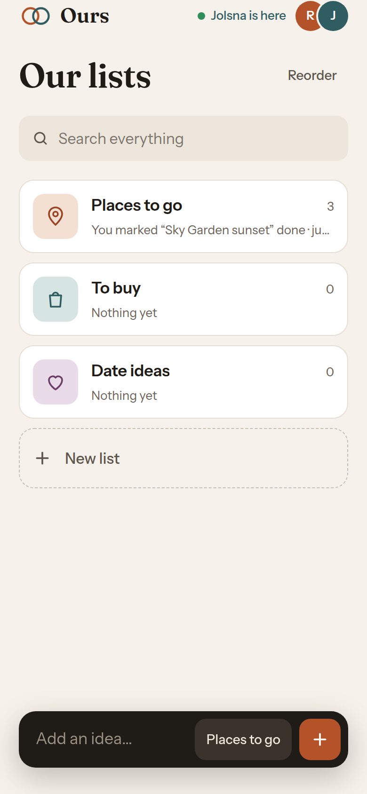
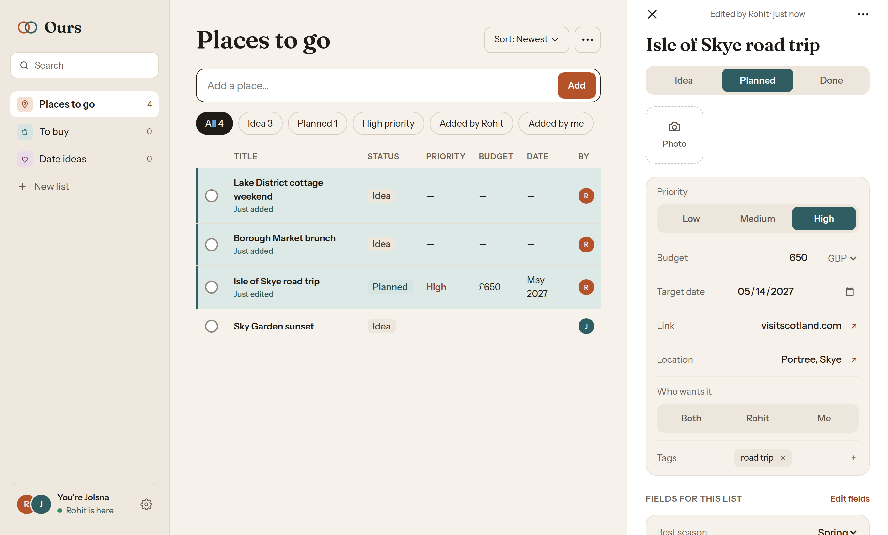

# Ours — a shared list for two

A private, live-synced list for a couple: places to go, things to buy, date ideas.
Either of you adds an idea in seconds and the other sees it instantly.

Runs on **Vercel**: Next.js on Vercel Functions in London (`lhr1`), **Neon Postgres** from the
Vercel Marketplace (provisioned and billed inside Vercel), and a **private Vercel Blob**
store for photos. The same app also ships as a **Docker image** that runs anywhere with a Postgres.

| Phone | Desktop |
|---|---|
|  |  |

## How it works

| Piece | Implementation |
|---|---|
| Access | A numeric code (`APP_PIN`) → `/api/unlock`, 5 wrong tries then a 15‑minute pause per IP → signed httpOnly cookie (60 days). A deployment holds one shared space |
| Data | Postgres (`db/schema.sql`). The browser never talks to the database: every route checks the cookie, validates input and scopes queries to the space |
| Live sync | Postgres triggers `pg_notify` on every change → `/api/events` (Server‑Sent Events, one shared `LISTEN` per function instance) → each device merges the row into its cache and highlights changes made by the other person |
| Conflicts | Only changed fields are sent; custom fields merge per key in `jsonb`, so edits to different fields never overwrite each other |
| Presence | 30 s heartbeat to `/api/presence`, broadcast the same way → "Jolsna is here" |
| Photos | Compressed on the phone (≤1600 px JPEG), uploaded to a **private** Blob store, served only through `/api/photos/[id]` after the cookie check |
| Offline | Last data cached on the device (readable offline); edits made offline queue in order and replay on reconnect; service worker caches the app shell and photos |
| Updates | Each build carries its commit id; the live-sync stream reports the server's, and an open app on an older build offers *Reload* |
| Health | `/api/health` (the process is up) and `/api/health/ready` (it can reach the database), both open without the code |
| UI | Tailwind CSS v4, Radix primitives (shadcn‑style), Framer Motion, TanStack Query. Light and dark themes (follows the system, with a manual override) |

## Deploy on Vercel (about 10 minutes)

1. **Import the repo** in Vercel → *Add New… → Project*.
2. **Add Postgres:** Project → *Storage* → *Create Database* → **Neon** (the free plan is fine).
   Connect it to the project. This adds `DATABASE_URL` and `DATABASE_URL_UNPOOLED`.
3. **Add Blob:** Project → *Storage* → *Create* → **Blob**, access **Private**. This adds `BLOB_READ_WRITE_TOKEN`.
4. **Set the unlock code:** Project → *Settings → Environment Variables* → `APP_PIN` = a 4–12 digit
   code, for Production and Preview. Changing it later, then redeploying, signs every device out.
5. **Deploy** (or redeploy). Each successful production build then applies the schema and, the first time, creates
   your space with three starter lists, so there's nothing to run by hand. Open the app on both
   phones, enter the code, pick your names, then *Share → Add to Home Screen*.

## Local development

```bash
npm install
cp .env.example .env.local   # point DATABASE_URL at any Postgres 14+, set APP_PIN
npm run setup                # schema + space (production builds do this themselves)
npm run dev
```

Photos need `BLOB_READ_WRITE_TOKEN`. Everything else works with a plain local Postgres.

Checks: `npm run lint`, `npm run typecheck`, `npm run build`, and the API tests against a running server:

```bash
APP_PIN=135790 TRUSTED_IP_HEADER=x-real-ip npm start        # in one terminal, after npm run build
APP_PIN=135790 npm test                                      # in another
```

The tests need a fresh database each run (the last one pauses unlocking for 15 minutes).

## Run with Docker

The image is a standalone Next.js server (Node 24, non-root, with a health check). On start it
applies the schema, creates the space the first time, then serves on port 3000.

```bash
APP_PIN=123456 docker compose up --build        # Postgres + the app on http://localhost:3000
```

Released images are published for every merge into `main`:

```bash
docker run -p 3000:3000 \
  -e DATABASE_URL=postgres://… -e APP_PIN=… -e SESSION_SECRET=… -e TRUSTED_IP_HEADER=x-real-ip \
  ghcr.io/rohitkf/poppy-wish-box:latest          # or :sha-<commit> to pin a release
```

| Variable | Needed | What it does |
|---|---|---|
| `DATABASE_URL` | Yes | Postgres 14+ connection string |
| `DATABASE_URL_UNPOOLED` | No | Direct connection for live sync and setup, if `DATABASE_URL` goes through a pooler |
| `APP_PIN` | Yes | The 4–12 digit unlock code |
| `SESSION_SECRET` | Recommended | Long random string that signs the session cookie (defaults to `DATABASE_URL`). Changing it signs every device out |
| `TRUSTED_IP_HEADER` | Behind a proxy | The header your proxy sets to the client's IP, e.g. `x-real-ip`, or `x-forwarded-for` (its last entry is used). Without it every visitor shares one lockout counter. Leave it unset if nothing in front sets it, or clients could forge it |
| `BLOB_READ_WRITE_TOKEN` | For photos | A private Vercel Blob store |
| `PG_POOL_MAX` | No | Database connections per instance (default 5) |
| `SKIP_DB_SETUP` | No | `1` when a separate step applies the schema (`node scripts/setup.mjs`) |

Serve it over HTTPS, behind a reverse proxy (Caddy, nginx, a cloud load balancer). The session
cookie is `Secure`, so plain HTTP only works on `localhost`. The proxy must not buffer
`/api/events` (Server-Sent Events). On `SIGTERM` the server closes open streams and exits within
a second, so rolling restarts are clean. Logs are JSON lines on stdout.

## CI/CD

| When | What runs |
|---|---|
| Every push to `develop` and every release PR into `main` | **CI** (`.github/workflows/ci.yml`): lint, typecheck, build, schema applied twice, then the API tests against `next start` on Postgres 17. A second job builds the Docker image, starts it with Postgres via Compose, and runs the same tests against the container |
| Every push to `develop` | Vercel preview deployment |
| A release PR merged into `main` | Vercel production deployment (the build applies the schema), and **Release image** (`.github/workflows/release.yml`) pushes `ghcr.io/rohitkf/poppy-wish-box` tagged `latest` and `sha-<commit>` |

Branch and release rules are in [AGENTS.md](AGENTS.md).

## Project map

```
app/
  page.tsx                 the whole app (one document, views in ?list=&item=&view=)
  unlock/                  code screen
  api/unlock|lock          session cookie
  api/data                 full snapshot for the space
  api/mutate               all writes (validated, space-scoped)
  api/events               live changes (SSE)
  api/presence             who's here
  api/photos               upload (private Blob) / stream
  api/health[/ready]       liveness / readiness checks
components/app/            screens: Home, ListView, ItemDetail, Sidebar, Settings…
lib/session.ts             APP_PIN check + signed unlock cookie
lib/space.ts               the deployment's one space
lib/server-data.ts         validation + SQL for every mutation
lib/realtime.ts            shared LISTEN connection → subscribers
lib/http.ts                request body limits, client IP
lib/client/store.ts        cache, optimistic updates, offline outbox, live merge
db/schema.sql              tables, triggers (idempotent)
scripts/setup.mjs          schema + space (run by production builds and on container start)
instrumentation.ts         one JSON log line per server error
tests/                     black-box API tests (node --test)
Dockerfile, docker-compose.yml, .github/workflows/
```

## Decisions on the PRD's open questions

| Question | Choice (easy to change) |
|---|---|
| Name | "Ours", as in the design |
| Currency | Per item, defaulting to a shared currency (GBP) set in Settings |
| Added by | Name picked once per device, from the names already used in the space |
| Deleting | Permanent, with a 5‑second Undo |
| Photo limits | 12 per item, compressed to ≤1600 px, 4 MB max after compression |
| Theme | Both, following the system, with a manual override |
| Hidden gift items, push notifications, reminders | Not built (P1/P2) |

## Limits

- Live sync streams restart every ~4.5 minutes (Vercel function duration). The client
  reconnects and refetches, so nothing is missed. A tab hidden for a minute closes its stream
  and catches up when it's shown again, so a forgotten tab doesn't keep the server and database awake.
- Uploading photos needs a connection. Other edits queue offline.
- The code is the only key, and a short one: the lockout allows 5 tries per 15 minutes per network,
  but can't stop someone guessing from many networks. While the repo is public, its Deployments
  list shows the app's address, so a private repo keeps it from strangers.
  *Settings → Lock this device* signs one device out; changing `APP_PIN` and redeploying signs out
  all of them. Vercel only applies changed environment variables to new deployments.
